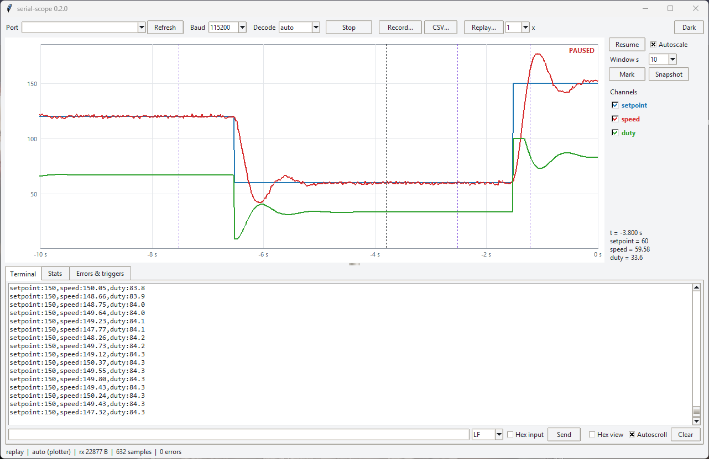
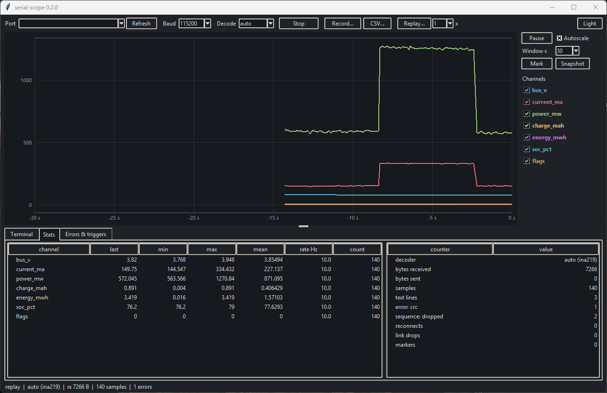

# serial-scope

[](https://github.com/projectbin07-stack/serial-scope/actions/workflows/ci.yml)
[](LICENSE)

A serial monitor, logger and live plotter that understands structured telemetry, for people
who live in the Arduino serial monitor.



*The screenshots show replayed synthetic demo data (`serial-scope demo`), not a live board.*

> **Status:** v0.1.0. Everything below is implemented and tested in CI on Linux and Windows,
> but **serial-scope has not yet been connected to a real board**. See
> [Hardware validation status](#hardware-validation-status).

## Why it exists

When firmware prints telemetry, the usual loop is: open the Arduino serial monitor, watch
numbers scroll, switch to the serial plotter, lose the data when the window closes, and copy
lines into a spreadsheet when something odd happens. Binary or checksummed formats are not
readable at all without writing a one-off script.

serial-scope keeps that workflow (a terminal with a send box, a live plot) and adds what is
missing for debugging: it decodes several line and binary formats, counts every checksum and
framing error instead of hiding it, records every byte with timestamps so a session can be
replayed exactly, and does all of that from a scriptable command line as well as a GUI.

### What exists already, and what this adds

| Tool | What it does well | What it does not do (as far as I know, at the time of writing) |
| --- | --- | --- |
| Arduino IDE 2 Serial Monitor / Plotter | Zero setup; plots `label:value` lines | No log file, no replay, no checksummed or binary formats; the port is held by one window |
| PuTTY | Robust terminal, session logging | No plotting, no decoding |
| CoolTerm | Terminal with hex view, capture to file | No plotting, no structured decoding |
| SerialPlot | Fast Qt plotting of ASCII, fixed binary layouts and simple custom frames | No COBS / CRC-16 framing, no JSON lines, no raw byte log for exact replay, no headless mode |
| pyserial `miniterm` | Minimal terminal in Python, hex filters | No plotting, logging or decoding |

serial-scope adds:

- **Decoding of several line and framed formats**, auto-detected or forced: plain text,
  Arduino-plotter lines, CSV with a header, JSON lines, the `$BM1` CRC-8 lines of
  [ina219-battery-monitor](https://github.com/projectbin07-stack/ina219-battery-monitor) and the
  COBS + CRC-16 binary frames of
  [encoder-odometry-firmware](https://github.com/projectbin07-stack/encoder-odometry-firmware).
  CRC, framing and format errors are counted and shown; sequence gaps and device restarts too.
- **Auto-discovered numeric channels** with ring buffers, min / max / mean and sample rate,
  plotted on host time or the device's own clock.
- **Reliable logging and replay**: every received and sent byte, with microsecond host
  timestamps, in a compact `.sslog` file that is flushed per record, rotates by size and can be
  replayed byte for byte at original or accelerated speed. Decoded CSV export.
- **Triggers**: thresholds with hysteresis, rising / falling edges and regular expressions on
  text, with mark, beep, stop-logging-after-N-seconds and snapshot actions.
- **A scriptable headless mode** with exit codes (`--max-errors`) for use in scripts and CI.
- **Auto-reconnect** when a board is unplugged, reset into its bootloader or re-enumerated.

What it does not try to be: a VT100 terminal emulator, a file-transfer tool, or a
high-performance plotter. The plot is drawn on a Tk Canvas and decimated to the window width;
it is meant for tens of channels at tens to hundreds of samples per second, and its
throughput limits have not been measured.

## Install

serial-scope needs Python 3.10 or newer. The only runtime dependency is pyserial; the GUI
uses Tk, which ships with the python.org installers for Windows and macOS (on Debian/Ubuntu:
`sudo apt install python3-tk`). It is not published on PyPI; install from GitHub:

```console
pip install git+https://github.com/projectbin07-stack/serial-scope.git
```

or from a clone with `pip install -e .`.

## Quick start on Windows

1. **Find the COM port.** Plug the board in and run `serial-scope list`. Each port is shown
   with its USB VID:PID and, for common chips, what it probably is:

   ```text
   COM5  10C4:EA60  Silicon Labs CP210x USB to UART Bridge (COM5)  [Silicon Labs CP210x (ESP32 DevKit, NodeMCU)]
   ```

   (That line shows the format; the machine this README was written on has no serial ports,
   so its real output was `no serial ports found`.) Without serial-scope: Device Manager >
   Ports (COM & LPT), then unplug and replug the board and see which entry disappears.
   CH340 boards (most Nano clones) need the WCH driver on older Windows versions; boards with
   native USB (ESP32-S3/C3, RP2040, Arduino Leonardo) appear as "USB Serial Device".
2. **Close other programs using the port.** Windows allows one program per COM port. If the
   Arduino IDE serial monitor, PlatformIO's monitor or an upload is running, opening fails with
   "Access is denied" and serial-scope keeps retrying until the port is free.
3. **Watch it.** `serial-scope gui` and pick the port, or from the terminal:

   ```console
   serial-scope monitor COM5 -b 115200 --log run.sslog
   ```

4. **Look at it again later.** `serial-scope replay run.sslog --speed 4`, `serial-scope stats
   run.sslog`, or open it in the GUI with *Replay...*.

No board at hand? `serial-scope demo demo.sslog` writes a synthetic session (an ESP32-style
motor speed loop at 50 Hz); `serial-scope gui --replay demo.sslog` plays it.

## Supported formats

Pick one with `--decode NAME` or leave the default `auto`. Auto-detection feeds the first
records to every decoder in parallel and commits to the most specific one that decodes at least
five records with few errors (or after 4 KiB / 3 s, whichever comes first). Everything received
during detection is then released by the winning decoder, so nothing is lost.

| Name | Example | Channels | Device time |
| --- | --- | --- | --- |
| `plotter` | `temp:21.5,hum:40` / `1.5 2.25 -3` | labels, or `ch1`, `ch2`, ... by position | - |
| `csv` | header `millis,adc0,adc1` then `50,2048,1000` | one per column | a `t_ms` / `millis` / `t_us` / `time` column |
| `jsonl` | `{"t_ms":1500,"temp":21.5,"imu":{"ax":0.1}}` | numbers and booleans, flattened (`imu.ax`) | a top-level `t_ms` / `millis` / ... key |
| `ina219` | `$BM1,42,21000,3876,100000,386000,583,2261,512,0*D1` | `bus_v`, `current_ma`, `power_mw`, `charge_mah`, `energy_mwh`, `soc_pct`, `flags` | `t_ms` |
| `odometry` | binary: `COBS(ver type seq len body crc16) 00` | `fl.velocity`, `odom.x`, `diag.max_loop_us`, ... | `t_us` (32-bit wrap handled) |
| `text` | anything | none | - |

Details:

- **Lines** may end in LF, CR LF or a lone CR, and may be split across any number of reads.
  Lines longer than 4096 bytes are reported as `overlong` and skipped. Invalid UTF-8 is shown
  with replacement characters rather than dropped. Lines that are not data (boot messages,
  `Serial.println("WiFi connected")`) are passed through as text in every line format.
- **plotter** follows the Arduino IDE 2 plotter conventions: values separated by commas,
  spaces or tabs, optionally `label:value`. A line with any token that is neither is text.
  `nan` / `inf` are recognised and left out of the plot.
- **csv** errors: `columns` (wrong number of fields) and `value` (a non-numeric field). A
  repeated header (after a board reset) is accepted and may change the columns.
- **ina219** re-implements the format documented in ina219-battery-monitor: CRC-8 (poly
  0x07) over everything between `$` and `*`. Errors: `crc`, `format`. Sequence numbers give
  `dropped` (frames missing) and `restarts` (counter went backwards). `#...` lines are text.
- **odometry** re-implements protocol version 1 of encoder-odometry-firmware
  ([docs/protocol.md](https://github.com/projectbin07-stack/encoder-odometry-firmware/blob/main/docs/protocol.md)):
  COBS framing with a `00` delimiter, CRC-16/CCITT-FALSE, all eight message types. Errors:
  `overlong` (more than 72 bytes between delimiters, e.g. the ESP32 ROM boot text), `cobs`,
  `short`, `crc`, `version`, `type`, `length`. Sequence gaps are counted as `lost`. A
  receiver that starts mid-stream, or after boot text without a delimiter, loses the first
  frame and resynchronises at the next `00`, as the protocol specifies.

Both firmware formats are tested against the reference data published in those repositories
(copied into [`tests/data`](tests/data/SOURCES.md) with their origin and commit).

## Command line

```text
$ serial-scope --help
usage: serial-scope [-h] [--version]
                    {list,monitor,replay,stats,decoders,demo,gui} ...

Serial monitor, logger and live plotter for structured telemetry.

positional arguments:
  {list,monitor,replay,stats,decoders,demo,gui}
    list                list serial ports with USB VID:PID
    monitor             read a serial port or TCP socket
    replay              play back a .sslog file
    stats               summarise a .sslog file
    decoders            list the available decoders
    demo                write a synthetic demo log (no hardware needed)
    gui                 open the graphical monitor

options:
  -h, --help            show this help message and exit
  --version             show program's version number and exit
```

`monitor` and `replay` share these options (`serial-scope monitor --help`):

```text
  -b, --baud BAUD       baud rate (default 115200)
  --no-reconnect        exit when the link drops
  --send TEXT           send TEXT once connected (\n etc. allowed)
  --decode {auto,ina219,odometry,jsonl,csv,plotter,text}
                        decoder (default: auto-detect)
  --log FILE.sslog      record every byte to a raw log
  --rotate-mb MB        start a new log part every MB
  --csv FILE.csv        export decoded samples as CSV
  --show {decoded,text,samples,raw,hex,none}
                        what to print: decoded events (default), text lines
                        only, samples only, raw bytes, a hex dump, or nothing
  --trigger SPEC        e.g. 'current_ma > 500 -> mark,snapshot', 'rise:v@3.3
                        -> beep', '/panic/ -> mark,stop:2' (repeatable)
  --hysteresis HYSTERESIS
                        threshold re-arm band
  --holdoff HOLDOFF     min seconds between firings
  --snapshot-dir SNAPSHOT_DIR
                        where snapshot CSVs go (default: .)
  --buffer BUFFER       points kept per channel
  --time-base {host,device}
                        x axis for snapshots: host receive time or device time
  --duration DURATION   stop after this many seconds
  --abs-time            print wall-clock times
  --max-errors N        exit with status 3 if there are more than N decode
                        errors
  -q, --quiet           no summary on stderr
```

(`--send` and `--no-reconnect` are `monitor` only; `replay` adds `--speed`, where 1 is the
original pace, 4 is four times faster and 0, the default, is as fast as possible.)

Sources for `monitor`: `COM5`, `/dev/ttyUSB0`, `tcp://192.168.4.1:3333` (an ESP32 serving
telemetry over Wi-Fi) or any [pyserial URL](https://pyserial.readthedocs.io/en/latest/url_handlers.html)
such as `rfc2217://host:port` or `loop://`.

Exit status: 0 on success, 2 for bad arguments or a source that could not be opened
(`--no-reconnect`), 3 when `--max-errors` is exceeded.

### Real output from the demo logs

Every block below is the unedited output of the command shown, run on the synthetic demo logs
(times are offsets from the first byte; the summary goes to stderr).

```text
$ serial-scope demo demo.sslog
wrote demo.sslog: synthetic 'plotter' session, 20 s, 1761 chunks, 43878 bytes

$ serial-scope stats demo.sslog
file        demo.sslog  (1 part(s), 43878 bytes)
source      demo:plotter  (synthetic demo data)
time        2025-11-19 11:00:00.000Z .. 2025-11-19 11:00:20.400Z
duration    20.401 s
records     rx 1761 (35844 bytes), tx 0, marks 0, info 0
decoder     auto (plotter)
decoded     1001 samples, 10 text lines
errors      none

channel      count         min         max        mean  rate Hz
setpoint      1001           0         150     82.5375     50.0
speed         1001      -45.17      176.77     82.5372     50.0
duty          1001       -60.7         100     45.9918     50.0
```

Triggers, text lines only, and a decoded CSV export (`re:` is the regex form that Git Bash
does not mistake for a path; `/RSSI/` works in cmd and PowerShell):

```text
$ serial-scope replay demo.sslog --show text --trigger "speed > 160 -> mark,snapshot" --trigger "re:RSSI -> mark" --csv demo.csv
[connected to replay:demo.sslog]
+    0.000s  ets Jun  8 2016 00:22:57
+    0.000s  
+    0.000s  rst:0x1 (POWERON_RESET),boot:0x13 (SPI_FAST_FLASH_BOOT)
+    0.000s  configsip: 0, SPIWP:0xee
+    0.001s  mode:DIO, clock div:2
+    0.001s  entry 0x400805e4
+    0.250s  [app] speed loop demo, 50 Hz
+    5.421s  [wifi] RSSI -61 dBm
+    5.421s  * trigger re:RSSI: line matched /RSSI/: [wifi] RSSI -61 dBm [mark]
+   10.421s  [wifi] RSSI -60 dBm
+   10.421s  * trigger re:RSSI: line matched /RSSI/: [wifi] RSSI -60 dBm [mark]
+   11.720s  * trigger speed > 160: speed = 162.07 > 160 [mark, snapshot]
+   15.421s  [wifi] RSSI -63 dBm
+   15.421s  * trigger re:RSSI: line matched /RSSI/: [wifi] RSSI -63 dBm [mark]
[replay:demo.sslog: end of data]
decoder auto (plotter); 35844 bytes in 20.401 s; 1001 samples, 10 text lines; errors: none
4 markers
snapshots: snapshot-20251119-163011-720.csv

$ head -3 demo.csv
host_time,device_time,source,setpoint,speed,duty
1763550000.400000,,plotter,0,1.03,0
1763550000.420000,,plotter,0,1.16,0
```

The ina219 demo contains one frame with a corrupted digit and one frame that never arrived.
Both show up, the first as a `crc` error, the pair as `dropped 2` in the sequence counter:

```text
$ serial-scope demo ina219.sslog --kind ina219
wrote ina219.sslog: synthetic 'ina219' session, 20 s, 450 chunks, 12364 bytes

$ serial-scope replay ina219.sslog --show text
[connected to replay:ina219.sslog]
+    0.000s  #ina219-battery-monitor 0.1.0
+    0.050s  #OK RATE 100
+    5.800s  $BM1,57,5799,3901,149664,583689,241,946,779,0*CD
+    5.800s  ! crc: checksum mismatch: got CD, computed E2
[replay:ina219.sslog: end of data]
decoder auto (ina219); 10319 bytes in 19.900 s; 197 samples, 3 text lines; errors: crc 1
sequence: dropped 2
```

The odometry demo starts with ESP32 ROM boot text on the binary port and contains one frame
with a flipped bit:

```text
$ serial-scope replay odometry.sslog --show text --speed 4 --duration 1
[connected to replay:odometry.sslog]
+    0.000s  ! overlong: more than 72 bytes between delimiters (starts b'ets Jun  8 2016 00:22:57')
+    2.600s  ! crc: CRC mismatch: frame has 4FA8, computed DC35
decoder auto (odometry); 8441 bytes in 4.000 s; 157 samples, 0 text lines; errors: crc 1, overlong 1
sequence: lost 1

$ serial-scope stats odometry.sslog
file        odometry.sslog  (1 part(s), 51165 bytes)
source      demo:odometry  (synthetic demo data)
time        2025-11-19 11:00:00.000Z .. 2025-11-19 11:00:19.951Z
duration    19.952 s
records     rx 1905 (43247 bytes), tx 0, marks 0, info 0
decoder     auto (odometry)
decoded     829 samples, 0 text lines
errors      crc 1, overlong 1
sequence    lost 1

channel                count         min         max        mean  rate Hz
odom.x                   396   -0.757384    0.742619   0.0668656     20.0
odom.y                   396  -0.000989697     1.49901      0.6278     20.0
odom.theta               396    -3.13619       3.127    0.108552     20.0
...
```

pyserial's `loop://` device echoes what is written to it, which exercises the real serial code
path without hardware:

```text
$ serial-scope monitor loop:// --send 'temp:21.5,hum:40\r\n' --duration 0.5 --log loop.sslog
[connected to loop://@115200]
decoder auto (plotter); 18 bytes in 0.000 s; 1 samples, 0 text lines; errors: none
+    0.000s  temp=21.5 hum=40
```

### Scripting examples

```console
# Log a long run, one file per 50 MB, CSV alongside, and mark every brown-out message
serial-scope monitor COM5 -b 921600 --log soak.sslog --rotate-mb 50 --csv soak.csv \
    --show none --trigger "re:Brownout -> mark,beep"

# Fail a hardware-in-the-loop script if the link produced any CRC or framing error
serial-scope replay soak.sslog --show none --max-errors 0

# Stop recording two seconds after a panic, keeping the lead-up
serial-scope monitor COM7 --log crash.sslog --trigger "re:Guru Meditation -> mark,stop:2"

# Machine-readable summary
serial-scope stats soak.sslog --json
```

## GUI

`serial-scope gui` (options: `--port`, `-b`, `--replay LOG`, `--speed`, `--decode`,
`--theme light|dark`, `--buffer`).

- **Toolbar:** port picker with Refresh (USB VID:PID and chip hints; you can also type
  `tcp://host:port` or a pyserial URL), baud rate, decoder, Connect / Disconnect, Record...
  (raw `.sslog`), CSV... (decoded export), Replay... with speed, light / dark theme.
- **Plot:** the last N seconds of every channel; autoscale or a held range; Pause freezes the
  view while data keeps arriving; moving the mouse shows the nearest value of every visible
  channel; channels toggle on and off; markers from triggers and the Mark button are drawn as
  dashed lines; Snapshot writes the buffered points to a CSV.
- **Terminal:** received text (control characters made visible) or a hex dump, a send box
  with None / LF / CR / CR+LF line endings, C escapes (`\n`, `\x1b`) or hex input.
- **Stats:** last, min, max, mean, rate and count per channel; bytes, samples, every error
  kind, sequence counters, reconnects, markers and trigger counts.
- **Errors & triggers:** a time-stamped list of every decode error and trigger firing, and a
  box to add triggers.

The reader runs in its own thread and hands chunks to the UI through a queue; the UI drains it
every 30 ms (at most 2000 items per tick) and redraws the plot at most 15 times a second, so a
fast stream delays the display rather than freezing the window. The queue is unbounded on
purpose: if the UI falls behind, data waits instead of being dropped.



## Log format

`.sslog` is a small binary format designed to be replayed exactly:

```text
header  = "SSLOG" version:u8 start_ns:u64 meta_len:u32 meta:JSON
record  = kind:u8 dt_us:uvarint length:uvarint payload
kinds   = 1 received bytes, 2 sent bytes, 3 marker text, 4 status text
```

Payloads are stored unmodified, each record costs about three bytes of overhead, and every
record is flushed as it is written. A file cut short by a crash or a full disk is read up to its
last complete record and reported as truncated. With `--rotate-mb` the parts are `run.sslog`,
`run_002.sslog`, ... and are read back as one stream.

## Architecture

```text
             +-------------------+        +---------------------+
 COM / TCP / | Transport         |  read  | ReconnectingSource  |  status events
 replay /    | serial, tcp,      +------->+ open, detect drops, +----------------+
 fake        | replay, fake      |        | backoff, reopen     |                |
             +-------------------+        +----------+----------+                |
                                                     | Chunk(bytes, host time)   |
                         GUI: ReaderThread -> queue -> AppController.poll()       |
                         CLI: run_stream() loop                                   |
                                                     v                           v
                                          +----------+----------+
                                          | Session             |---> LogWriter (.sslog)
                                          |  Decoder (auto/...) |---> CsvExporter
                                          |  ChannelSet         |---> TriggerSet -> actions
                                          +----------+----------+
                                                     | events: TextLine, Sample,
                                                     | DecodeError, TriggerFired
                                                     v
                                  terminal / stats / plot (plotmodel -> Tk Canvas)
```

| Module | Responsibility |
| --- | --- |
| `transport.py`, `ports.py` | `Transport` interface; serial, TCP, replay and fake transports; port listing |
| `connection.py`, `reader.py` | reconnect state machine; background reader thread and queue |
| `decoders/` | `Decoder` base and line splitter, the six formats, auto-detection, registry |
| `channels.py` | ring buffers, running stats, rates, channel discovery |
| `logfile.py`, `csvexport.py` | `.sslog` writer / reader with rotation; decoded CSV and snapshots |
| `triggers.py`, `session.py` | trigger parsing and evaluation; the pipeline tying it together |
| `app.py`, `plotmodel.py`, `terminal.py` | GUI logic without Tk: controller, plot geometry, text and hex rendering |
| `gui.py` | the Tk widgets and their wiring only |
| `cli.py`, `demo.py` | command line; synthetic demo sessions |

### Adding a decoder

Line-based formats subclass `LineDecoder` and implement `decode_line`; binary formats
subclass `Decoder` and implement `feed`, keeping partial frames between calls. Report problems
with `self.error(...)` so they are counted, then register the class:

```python
from serial_scope.decoders import LineDecoder, register_decoder
from serial_scope.events import Event, Sample


class NmeaDepthDecoder(LineDecoder):
    name = "depth"
    description = "$SDDPT depth sentences"

    def decode_line(self, t: float, text: str, raw: bytes) -> list[Event]:
        if not text.startswith("$SDDPT,"):
            return [self.text(t, text)]
        try:
            depth = float(text.split(",")[1])
        except (IndexError, ValueError):
            return [self.text(t, text), self.error(t, "format", f"bad DPT: {text!r}", raw)]
        return [Sample(t, {"depth_m": depth}, source="DPT")]


register_decoder(NmeaDepthDecoder, auto_rank=35)  # omit auto_rank to exclude from auto
```

Test it the way the built-in decoders are tested: feed a fixture stream in chunk sizes down
to one byte, with garbage between records and corrupted checksums, and check the counters.

## Testing

```console
pip install -e ".[dev]"
ruff check . && ruff format --check . && mypy && pytest --cov
```

The suite (228 tests) covers:

- every decoder on fixture streams split at chunk sizes from 1 byte up, with garbage between
  frames, corrupted CRCs, overlong lines and frames, and auto-detection of every format
  (checked to produce exactly the same events as the explicit decoder);
- the odometry decoder and COBS / CRC-16 code against all vectors in the encoder-odometry
  shared vector file (messages, invalid frames, COBS edge cases), and the ina219 decoder
  against that project's frame fixtures and sample session, matching its own logger's
  summary (5 frames, 2 bad lines, 1 dropped, 1 restart);
- ring buffers, statistics against Python's `statistics` module, rates;
- `.sslog` round trips that are byte-exact, microsecond timestamps, truncation, rotation;
- trigger logic (hysteresis, edges, holdoff, regex, actions);
- reconnection with exponential backoff using the fake transport and a fake clock, and the
  reader thread delivering every chunk in order across a simulated unplug;
- the serial transport through pyserial's `loop://` device and the TCP transport against a
  local socket server;
- the CLI commands, and the GUI controller without Tk;
- a smoke test that builds the real Tk window and replays a demo log through it. It is
  skipped when no display is available; CI runs it under `xvfb-run` on Ubuntu and natively on
  Windows, and sets `SERIAL_SCOPE_REQUIRE_GUI=1` so it cannot silently skip there.

Coverage is measured without `gui.py`, the thin Tk view (widget construction and event
wiring); its logic lives in `app.py`, `plotmodel.py` and `terminal.py`, which are measured, and
`gui.py` itself is exercised by the smoke test. Local coverage of the rest is 98 %.

## Hardware validation status

Stated plainly:

- **Not done:** serial-scope has **not been connected to a real board or USB-serial adapter**
  by its author. No Arduino, ESP32 or STM32 has been read, no cable has been unplugged under
  it, and the ESP32 TCP path has not talked to an ESP32.
- **Done:** the serial transport has been exercised through pyserial's `loop://` device, the
  TCP transport against a local socket server, the reconnect logic with a scripted fake
  transport, the decoders against the firmware projects' reference vectors and fixtures
  (themselves not hardware captures), and the GUI on Windows 11 by replaying synthetic logs
  (the screenshots) and in CI under Xvfb.
- **Therefore unverified:** behaviour of real USB-serial drivers on unplug and replug
  (Windows may report this as different exceptions or delays than the fake transport
  simulates), DTR/RTS auto-reset interaction, sustained throughput at high baud rates and how
  many channels the Canvas plot can keep up with, and the GUI on macOS.

If you run it against a board, an issue describing the board, adapter, OS and what happened
(working or not) is very welcome, and this section will be updated.

## Known limitations

- Not hardware-validated (above).
- One port per window / process; no side-by-side comparison of two devices.
- The plot shows a sliding time window; there is no zoom or pan into older data (replay the
  log or open the CSV for that). Only the last `--buffer` points per channel are kept in
  memory; the log keeps everything.
- Auto-detection needs a few records. A stream that mixes formats (JSON and plotter lines from
  the same board) is decoded with whichever wins; force a decoder if it guesses wrong.
- The terminal does not interpret ANSI escape sequences; they are shown as `<ESC>[...`.
- The odometry decoder decodes what it receives; it does not send commands or parameters
  (use the send box with hex input for raw bytes, or the firmware's own host tool).
- The TCP transport is a plain client: no TLS, no authentication, no UDP.
- Snapshot and CSV timestamps are host times in Unix seconds; the GUI x axis is relative to
  the newest sample.

## Roadmap

- Try it on real boards (ESP32 CP210x and native USB, Nano CH340, STM32 Nucleo ST-LINK VCP) and
  record what happened here.
- Measure plot and decode throughput and publish the numbers with the method.
- Zoom and pan on paused data; XY plot (e.g. `odom.x` vs `odom.y`).
- Sending odometry commands and parameter requests from the GUI.
- A user plug-in directory for decoders without editing the package.

## Contributing

See [CONTRIBUTING.md](CONTRIBUTING.md). Security reports: [SECURITY.md](SECURITY.md).

## License

[MIT](LICENSE) © 2026 Navaneeth KG
